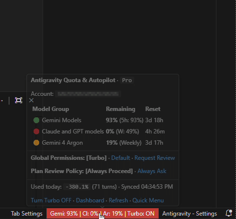
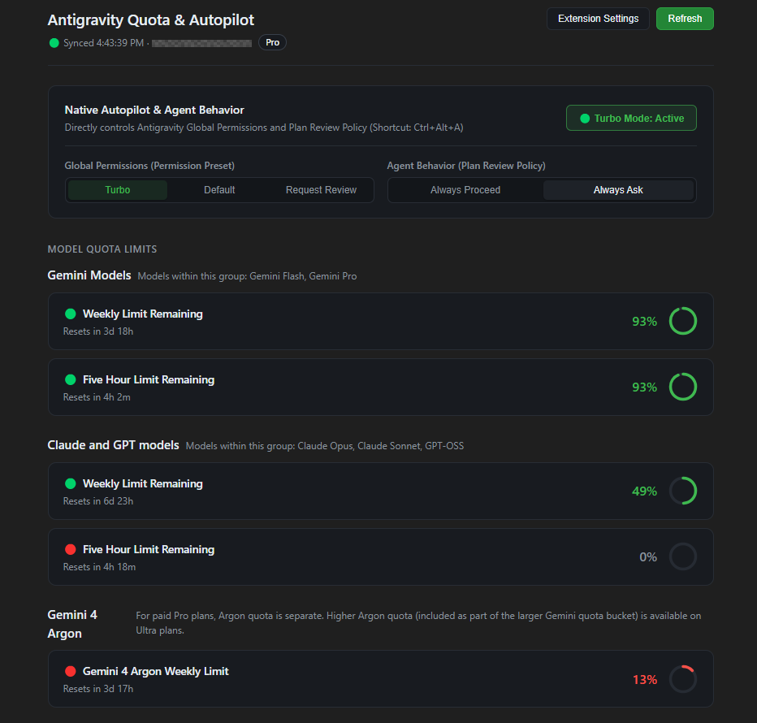

# Antigravity AI Quota & Auto-Accept Autopilot

A minimalist, native companion extension for **Google Antigravity IDE (v2.6.0+)** — featuring **1-Click Native Turbo Autopilot**, instant **Global Permissions & Plan Review Policy** controls (`Ctrl+Alt+A`), dynamic **Multi-Model AI Quota Tracking** across **Free / Pro / Ultra** accounts (including **Gemini 4 Argon**), and an automated **1,000-Turn Activity Logger**.

---

  
   
  <em>Minimalist Status Bar &amp; Hover Controls: View real-time multi-model quotas (Gemini, Claude/GPT, Argon) and switch Global Permissions or Plan Review Policy in 1 click.</em>

---

## What's New in v1.2.0

- **Universal Account & Multi-Model Support (Free / Pro / Ultra)**:
  - Dynamically detects and displays all model groups available on your account tier without hardcoded assumptions.
  - Full support for newly separated model buckets such as **Gemini 4 Argon** (`Ar: 32%`) alongside **Gemini Models** (`Gemi`) and **Claude and GPT models** (`Cl`).
  - Clean support for **Free** accounts (displays only available Gemini buckets without broken `--%` placeholders).
- **Native Turbo Autopilot & Agent Behavior Controls (Zero Port 9333 Required)**:
  - Completely replaces legacy CDP Port 9333 / DOM injection with Antigravity v2.6.0's native `JetboxWriteState` engine RPC.
  - Instantly switch **Global Permissions** (`Turbo` / `Default` / `Request Review`) and **Plan Review Policy** (`Always Proceed` / `Always Ask`) from the Status Bar, Hover Tooltip, Dashboard, or **`Ctrl+Alt+A`** (`Cmd+Alt+A` on macOS) shortcut without opening Settings.
- **Minimalist Developer UI**:
  - Distraction-free typography across the Status Bar, Hover Tooltip, Quick Menu, Sidebar, and Dashboard — retaining only functional status dots (`🟢`, `🟡`, `🔴`) for quota health.

---

## Key Features

### 1. Native Turbo Autopilot & Quick Shortcut (`Ctrl+Alt+A`)
Control Antigravity's execution permissions and plan review behavior in a single click or keystroke — no debug ports, no shortcut patching, and no IDE restarts required.

- **1-Click Status Bar Toggle**: Click the status bar item to toggle **Turbo Autopilot** (`Turbo: ON` <-> `Turbo: OFF`).
- **Quick Menu (`Ctrl+Alt+A` / `Cmd+Alt+A`)**: Quickly switch individual settings anytime:
  - **Global Permissions (`Permission Preset`)**: `Turbo`, `Default`, or `Request Review`
  - **Agent Behavior (`Plan Review Policy`)**: `Always Proceed` or `Always Ask`
- **Interactive Hover Tooltip**: Hover over the status bar item to view all model reset timers and switch Global Permissions or Plan Review Policy directly inside the tooltip.

---

### 2. Dynamic Multi-Model Quota Tracking
Adapts automatically to whatever plan and model groups your account has:

  

- **Pro / Ultra Multi-Model**: `Gemi: 95% | Cl: 100% | Ar: 32% | Turbo: ON`
- **Free Tier**: `Gemi: 95% | Turbo: ON`
- **Compact / Smart Lowest Modes**: `Quota: 32% (Ar) | Turbo: ON`
- **Status Indicators**:
  - 🟢 **Healthy**: `> 35%` remaining quota
  - 🟡 **Low**: `16% – 35%` remaining quota
  - 🔴 **Critical**: `<= 15%` remaining quota

---

### 3. Minimalist Dashboard & 1,000-Turn Activity Logger

  

- **Live Native Controls**: Segmented controls for Global Permissions and Plan Review Policy synced in real time with `~/.gemini/config/config.json` and the Antigravity daemon.
- **Dynamic Quota Cards**: Clean progress rings and live reset countdowns for every bucket on your account.
- **Automated Activity Log**: Tracks per-turn quota deltas paired with prompt snippets (up to 1,000 local records).

---

## Shortcuts & Commands

| Command | Shortcut / ID | Description |
|---|---|---|
| **Open Autopilot & Quota Quick Menu** | `Ctrl+Alt+A` (`Cmd+Alt+A`) | Opens quick menu to toggle Turbo, Permissions, and Plan Review Policy. |
| **Toggle Turbo Autopilot (ON/OFF)** | `antigravityLimitMonitor.toggleTurbo` | Toggles full hands-free Turbo mode ON or OFF. |
| **Set Global Permissions** | `antigravityLimitMonitor.setPermissionPreset` | Choose `Turbo`, `Default`, or `Request Review`. |
| **Set Plan Review Policy** | `antigravityLimitMonitor.setPlanReviewPolicy` | Choose `Always Proceed` or `Always Ask`. |
| **Show Quota & Autopilot Dashboard** | `antigravityLimitMonitor.showDashboard` | Opens the minimalist visual dashboard and activity log. |
| **Refresh Model Quota Limits** | `antigravityLimitMonitor.refresh` | Forces an immediate quota sync from the Antigravity Engine. |
| **Switch Status Bar Display Mode** | `antigravityLimitMonitor.toggleDisplayMode` | Choose `All`, `5h Preferred`, `Gemini Only`, `Compact`, or `Smart Lowest`. |
| **Clear Activity History Logs** | `antigravityLimitMonitor.clearHistory` | Clears recorded activity history logs. |

---

## Installation

### Method 1: Install from Open VSX Registry
1. Open the Extensions view (`Ctrl+Shift+X` / `Cmd+Shift+X`) in Antigravity IDE.
2. Search for **`Antigravity AI Quota & Auto-Accept Autopilot`** (or `san-chanadach`).
3. Click **Install**.

### Method 2: Install from `.vsix` Release
1. Download `antigravity-quota-autopilot-1.2.0.vsix` from [GitHub Releases](https://github.com/San-chanadach/antigravity-quota-autopilot/releases).
2. Open Command Palette (`Ctrl+Shift+P` / `Cmd+Shift+P`) -> **Extensions: Install from VSIX...**.
3. Select the `.vsix` file and reload the window.

---

## Support & Buy Me a Coffee

---

## Author

Developed and maintained by **San Chanadach** ([@San-chanadach](https://github.com/San-chanadach)).

## License

MIT License - see [LICENSE](LICENSE) for details.
