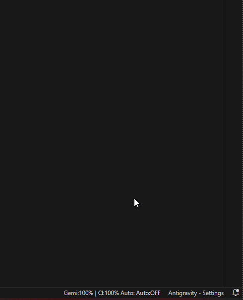
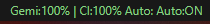
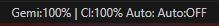
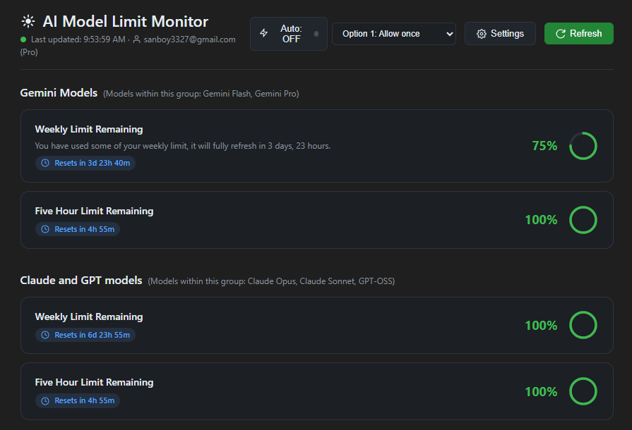
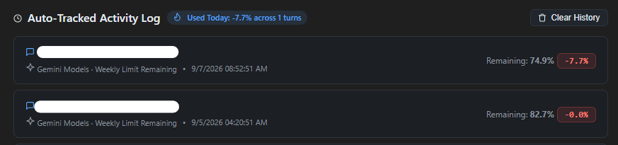

# Antigravity AI Quota & Auto-Accept Autopilot

[](https://open-vsx.org/extension/san-chanadach/antigravity-quota-autopilot)
[](https://github.com/San-chanadach)
[](https://ko-fi.com/sanchanadach)
[]()
[](https://opensource.org/licenses/MIT)

An all-in-one companion extension designed exclusively for **Google Antigravity IDE (Version: 2.5.5)** — featuring hands-free **Auto-Accept Autopilot** for agent actions, real-time **AI Quota Tracking** (Gemini & Claude), an interactive **Visual Dashboard**, and an automated **1,000-Turn Activity History Logger**.

---

<p align="center">
  
  <br />
  <em>Interactive Status Bar: Hover to view real-time model quotas, countdown reset timers, and switch Auto-Accept modes in 1 click!</em>
</p>

---

## What Can This Extension Do?

### 1. ⚡ Hands-Free Auto-Accept (Autopilot)
Tired of constantly clicking "Accept" and "Allow" dozens of times during multi-step agent coding sessions? The built-in Autopilot handles permissions automatically while keeping you in full control.

| Auto Active (`Auto: ON`) | Auto Paused (`Auto: OFF`) |
|:---:|:---:|
|  |  |

- **1-Click Direct Toggle**: Click the status bar item anytime to instantly toggle Autopilot `ON` ↔ `OFF`.
- **Hover Option Selector**: Hover your mouse over the status bar item to view the active setting and click to switch options directly inside the tooltip without opening dialog menus!

#### 3 Smart Safety Modes:
- **Option 1: Allow once (`Single prompt`)**: Approves the current step only — ideal for high-security tasks requiring step-by-step verification.
- **Option 2: In conversation (`Recommended`)**: Auto-approves code edits and terminal commands within the current chat session to keep coding uninterrupted.
- **Option 3: Always allow (`Permanent`)**: Full hands-free automation for long, autonomous, or overnight development tasks.

---

### 2. 📊 Real-Time AI Quota Tracking (Status Bar)
Never get caught off guard by sudden model quota limits mid-task.

- **Clean Status Bar Display**: `Gemi:80% | Cl:80% Auto: ON`
- **Multi-Window Support**: Tracks rolling 5-Hour and Weekly limit windows for Google Gemini (3.7 / 3.1 Pro & Flash) and Anthropic Claude (3.7 Sonnet / 3.5 Sonnet).
- **Smart Color Health Cues**:
  - 🟢 **Healthy**: `> 35%` remaining quota
  - 🟡 **Warning**: `15% – 35%` remaining quota
  - 🔴 **Critical**: `< 15%` remaining quota (status bar alerts with error styling)
- **Countdown Timers**: Tooltips show the exact countdown until your rolling quota window resets.

---

### 3. 🎨 Interactive Visual Analytics Dashboard
A modern, dark-themed dashboard built for real-time monitoring of all your AI models.



- **Circular Animated SVG Gauges**: High-resolution vector gauges displaying remaining percentages for each model family.
- **Live Reset Timers**: Real-time countdowns for both weekly and 5-hour rolling windows.
- **Quick Controls**: Toggle Autopilot ON/OFF, change permission levels, and force refresh quotas directly from the dashboard header.

---

### 4. 🕒 100% Automated Activity Logger (1,000 Turns)
Keep an accurate record of your AI usage and understand where your quota is being spent.



- **Prompt Snippet Tagging**: Automatically detects and pairs each quota drop with your actual prompt text.
- **Zero-Manual Effort**: Automatically records every AI prompt/turn without needing to click Start or Stop.
- **1,000-Turn FIFO History**: Stores your last 1,000 interactions locally in extension storage.
- **Today's Stats Summary**: Quick glance at total percentage consumed today across all requests.
- **Pagination**: Smooth 10-items-per-page pagination (`Page 1 of 100`) with instant Clear History support.

---

## ⚙️ Requirements & Setup

### 1. Supported Platform
- **Google Antigravity IDE**: **Version 2.5.5** (tested and verified).

### 2. Autopilot Remote Debugging Port (`--remote-debugging-port=9333`)
To enable the **Autopilot (Auto-Accept)** engine to automatically select permission options (**Option 1 / Option 2 / Option 3**) and submit confirmation dialogs hands-free, **Antigravity IDE must be launched with the `--remote-debugging-port=9333` flag**.

#### How to configure:

- **Method A: Desktop / Taskbar Shortcut (Recommended)**
  1. Right-click your **Antigravity IDE** shortcut &rarr; select **Properties**.
  2. In the **Shortcut** tab, find the **Target** field.
  3. Append ` --remote-debugging-port=9333` at the end of the line (ensure there is a space before `--`), for example:
     ```text
     "C:\Users\<YourUsername>\AppData\Local\Programs\Antigravity IDE\Antigravity IDE.exe" --remote-debugging-port=9333
     ```
  4. Click **Apply** and **OK**. Always launch Antigravity IDE via this shortcut.

- **Method B: Terminal / PowerShell**
  ```powershell
  & "C:\Users\$env:USERNAME\AppData\Local\Programs\Antigravity IDE\Antigravity IDE.exe" --remote-debugging-port=9333
  ```

> **Note:** The **Real-Time Quota Monitor**, **Activity Tracker**, and **Visual Dashboard** work out of the box via the local Language Server without requiring any flags. The `--remote-debugging-port=9333` flag is specifically required for the hands-free Autopilot modal automation.

---

## 📦 Installation

### Method 1: Install from Open VSX Registry (Recommended)
1. In Antigravity IDE, open the Extensions view (`Ctrl+Shift+X` / `Cmd+Shift+X`).
2. Search for **`Antigravity AI Quota & Auto-Accept Autopilot`** (or `san-chanadach`).
3. Click **Install**.

### Method 2: Install from `.vsix` Release
1. Download the latest `antigravity-quota-autopilot-1.1.2.vsix` from [GitHub Releases](https://github.com/San-chanadach/antigravity-quota-autopilot/releases).
2. Open Antigravity IDE.
3. Open Command Palette (`Ctrl+Shift+P` / `Cmd+Shift+P`) and choose **Extensions: Install from VSIX...**.
4. Select the downloaded `.vsix` file and reload the window.

---

## 🛠️ Contributed Commands

| Command | Identifier | Description |
|---|---|---|
| **Toggle Auto-Accept (ON/OFF)** | `antigravityLimitMonitor.toggleAutoAccept` | Quickly toggles hands-free step & terminal approvals. |
| **Set Auto-Accept Option** | `antigravityLimitMonitor.setAutoAcceptChoice` | Opens quick-pick to select Option 1, 2, or 3. |
| **Show Limit Monitor Dashboard** | `antigravityLimitMonitor.showDashboard` | Opens the full visual webview dashboard and activity logs. |
| **Clear Activity History Logs** | `antigravityLimitMonitor.clearHistory` | Clears the 1,000 saved activity history records. |
| **Refresh Model Limits** | `antigravityLimitMonitor.refresh` | Forces an immediate quota refresh from the Language Server. |
| **Switch Status Bar Display Mode** | `antigravityLimitMonitor.toggleDisplayMode` | Switches status bar text formatting style. |
| **Open Limit Monitor Quick Menu** | `antigravityLimitMonitor.openQuickMenu` | Opens the consolidated action menu. |

---

## ☕ Support & Buy Me a Coffee

If you find **Antigravity AI Quota & Auto-Accept Autopilot** useful and it saves you time, please consider buying me a coffee to support continued development and maintenance!

[](https://ko-fi.com/sanchanadach)

Your support is deeply appreciated! ❤️

---

## Author

Developed and maintained by **San Chanadach** ([@San-chanadach](https://github.com/San-chanadach)).

---

## License

This project is licensed under the [MIT License](LICENSE).
